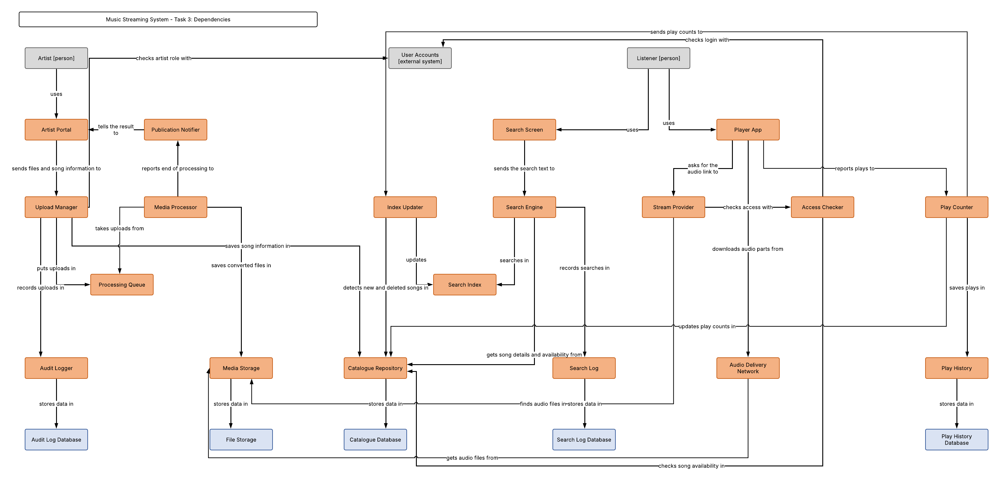
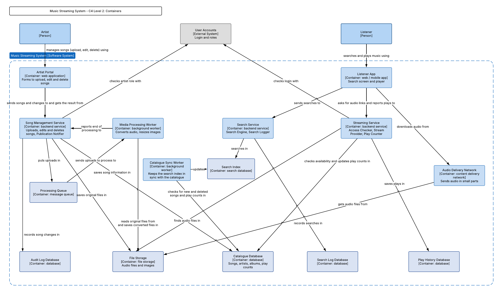
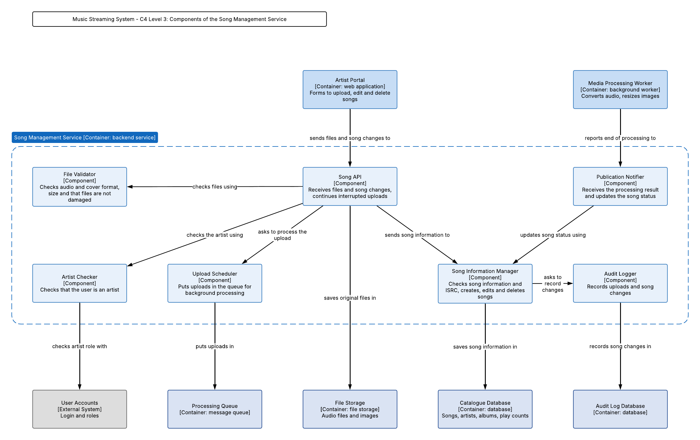
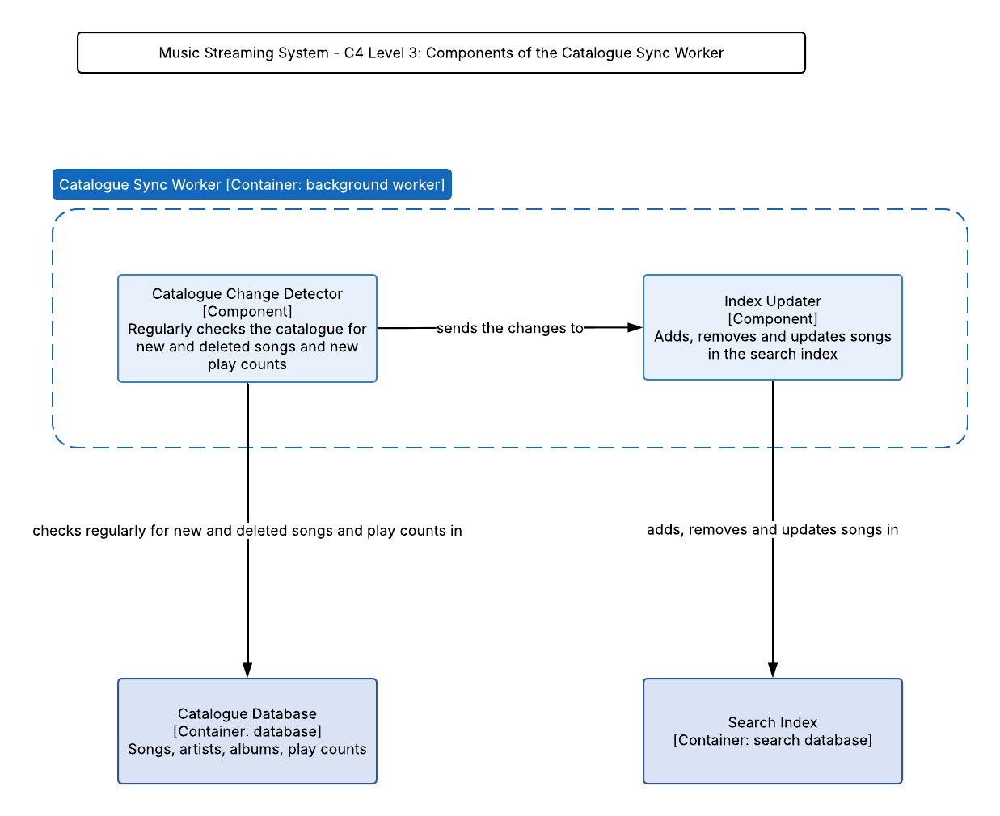
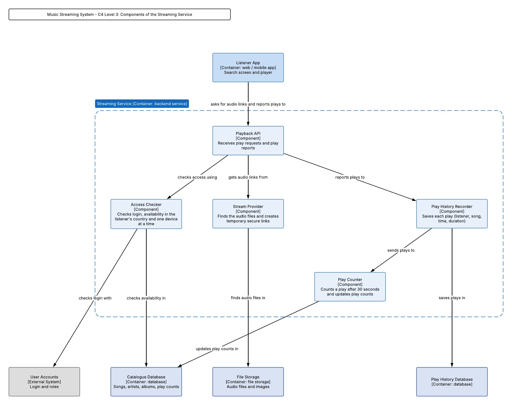
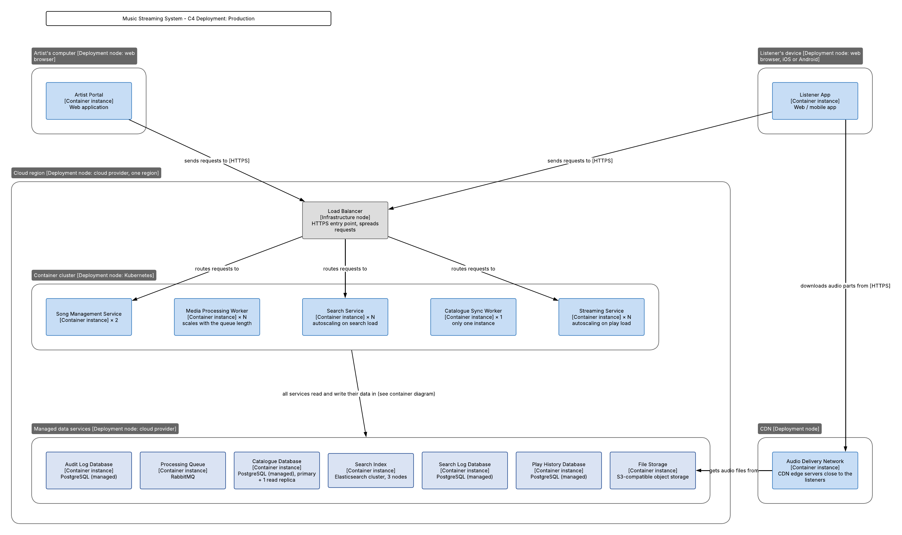
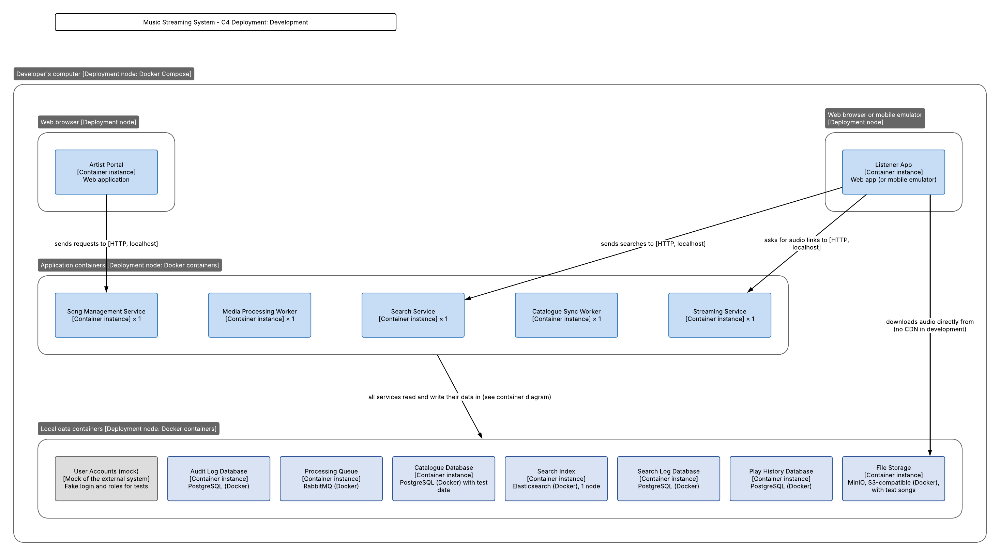
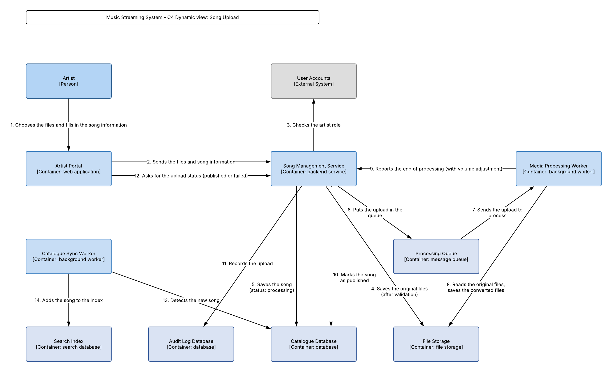
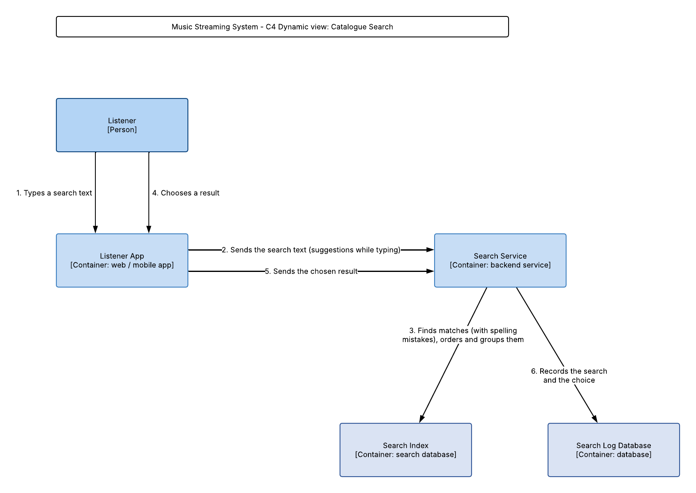
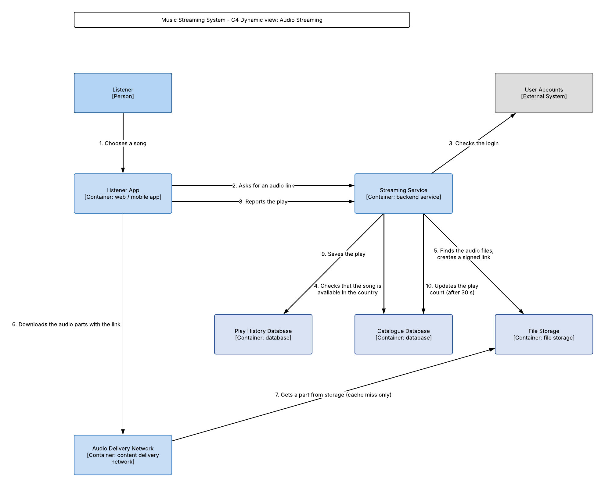

# Music Streaming System – Architecture (first draft)

This document contains our architecture work for the core features
Song Upload, Catalogue Search and Audio Streaming (see `features.md`).

## Task 2: Architecture decomposition

For each business area (one per core feature), we placed every responsibility in a layer
(Presentation, Business/Application, Persistence/Infrastructure). Then we grouped the
responsibilities that belong together into modules.

Lucid diagram: [Task 2 - Architecture decomposition (Lucidchart)](https://lucid.app/lucidchart/8a13cb37-50fd-452a-9b3b-f8d91db97765/view)

### Why we split the modules like this

**Song Upload**

- Upload Manager: all its steps work one after another to accept one valid upload.
- Media Processor is separate because converting audio is slow and must scale on its own.
- Publication Notifier is only responsible for notifications: it tells the artist the result of the upload.

**Catalogue Search**

- Search Engine: each step uses the result of the step before to answer one search.
- Index Updater is separate because it runs in the background: it watches the catalogue for new or deleted songs and updates the index.

**Audio Streaming**

- Player App runs on the listener's device; all its responsibilities are needed for continuous playback.
- Access Checker: all its responsibilities answer one question: "can this listener play this song now?"
- Audio Delivery Network is separate because it carries the biggest load and must scale on its own.

### Shared modules

- Catalogue Repository: used by Upload, Search and Streaming
- Media Storage: used by Upload and Streaming
- Audit Logger: can be used by all features

## Task 3: Dependencies

We kept only the modules, added the databases and the external elements (Artist, Listener,
User Accounts), and drew the dependencies between modules.

Diagram: [Task 3 - Dependencies (Lucidchart, page 2)](https://lucid.app/lucidchart/8a13cb37-50fd-452a-9b3b-f8d91db97765/view)

### Main design choices

- Song Upload does not depend on Search: Index Updater watches the Catalogue Repository for new or deleted songs.
- Catalogue Repository and Media Storage are the shared modules: Upload writes to them, Search and Streaming read from them.
- User Accounts is an auxiliary feature, so it is shown as an external system.

## C4 model

### Level 1: System Context

### Level 2: Containers

Changes after the teacher's feedback (19/11):

- The artist uses a **Song Management Service**, not only an upload service: it uploads, edits and deletes songs.
- The **Processing Queue** sends the uploads to the **Media Processing Worker** (the arrow goes from the queue to the worker).
- The **Song Management Service** saves the original files in the File Storage; the queue only carries a reference to
  the upload, and the Media Processing Worker reads the original files from the File Storage.
- A new **Catalogue Sync Worker** checks the Catalogue Database for new and deleted songs and play counts,
  and updates the Search Index (see Level 3 below).

Why the Catalogue Sync Worker is a separate container (and not a component of the Search Service):

- It runs in the background on a schedule, while the Search Service answers listener requests.
- The Search Service runs on many instances to handle the search load. The sync worker must run on **one instance**:
  if it ran inside every Search Service instance, each song would be added to the index several times.
- It is the only container that writes to the Search Index; the Search Service only reads from it.
- If the worker stops, search still works; the index is only a bit late.
- The Song Management Service and the Streaming Service do not need to know about search: they only write to the Catalogue Database.

### Which modules are in which container

| Container                                                                                        | Modules                                                     |
| ------------------------------------------------------------------------------------------------ | ----------------------------------------------------------- |
| Artist Portal (web application)                                                                  | Artist Portal                                               |
| Listener App (web / mobile app)                                                                  | Search Screen, Player App                                   |
| Song Management Service (backend service)                                                        | Upload Manager, Publication Notifier, Audit Logger          |
| Media Processing Worker (background worker)                                                      | Media Processor                                             |
| Search Service (backend service)                                                                 | Search Engine, Search Log                                   |
| Catalogue Sync Worker (background worker)                                                        | Catalogue Change Detector, Index Updater                    |
| Streaming Service (backend service)                                                              | Access Checker, Stream Provider, Play Counter, Play History |
| Processing Queue (message queue)                                                                 | Processing Queue                                            |
| Search Index (search database)                                                                   | Search Index                                                |
| Audio Delivery Network (content delivery network)                                                | Audio Delivery Network                                      |
| Catalogue Database, File Storage, Audit Log Database, Search Log Database, Play History Database | Catalogue Repository, Media Storage and the logs' storage   |

### Level 3: Components

We show the component diagrams of the three containers with the most important responsibilities:
the Song Management Service (core of Song Upload), the Catalogue Sync Worker (keeps search up to date)
and the Streaming Service (core of Audio Streaming). The other containers have component diagrams in Lucid.

#### Song Management Service

- **Song API**: entry point for the Artist Portal; receives files and song changes and continues interrupted uploads.
- **Artist Checker**: checks with User Accounts that the user is an artist.
- **File Validator**: checks the audio and cover format, size and that the files are not damaged.
- **Song Information Manager**: checks the song information and the ISRC code, creates, edits and deletes songs in the catalogue.
- **Upload Scheduler**: puts the upload in the Processing Queue.
- **Publication Notifier**: receives the end of processing and updates the song status (published or failed).
- **Audit Logger**: records uploads and song changes in the Audit Log Database.

#### Catalogue Sync Worker

- **Catalogue Change Detector**: regularly checks the Catalogue Database for new and deleted songs and new play counts.
- **Index Updater**: adds, removes and updates songs in the Search Index.

#### Streaming Service

- **Playback API**: receives play requests and play reports from the Listener App.
- **Access Checker**: checks the login, that the song is available in the listener's country, and one device at a time per account.
- **Stream Provider**: finds the audio files and creates temporary, secure links to the Audio Delivery Network.
- **Play History Recorder**: saves each play (listener, song, time, duration) in the Play History Database.
- **Play Counter**: counts a play only after 30 seconds and updates the play counts in the Catalogue Database.

Lucid diagrams: [C4 model (Lucidchart, pages 3 to 16)](https://lucid.app/lucidchart/8a13cb37-50fd-452a-9b3b-f8d91db97765/view)

### Deployment

#### Production

Technologies (open source and not tied to one cloud provider):

| Element | Technology | Why |
| --- | --- | --- |
| Services | Docker containers on **Kubernetes** | Autoscaling, restart after a failure, standard for containers |
| Catalogue Database | **PostgreSQL** (managed), primary + 1 read replica | The data is very related (song → album → artist); the replica takes the read load |
| Search Index | **Elasticsearch**, cluster of 3 nodes | Full-text search with spelling mistakes, suggestions and ranking; keeps working if one node fails |
| Processing Queue | **RabbitMQ** | Task queue: each upload is processed by one worker, with acknowledgement and retry |
| File Storage | **S3-compatible object storage** | Standard for large files; the CDN can read from it directly |
| Audit Log, Search Log, Play History | **PostgreSQL** (managed) | One database technology for the whole system; Play History could move to a column database if the volume grows a lot |
| Load balancer, CDN | Provided by the cloud provider | Not tied to one provider |

- The listener app runs on the listener's device (web browser, iOS or Android), the artist portal in the artist's browser.
- All requests go through a **load balancer** (HTTPS) to the services in a **container cluster** (Kubernetes) in one cloud region.
- Number of instances:
  - Song Management Service: 2 (enough for uploads, and one can fail).
  - Search Service and Streaming Service: N, with **autoscaling** on the search and play load.
  - Media Processing Worker: N, scaled on the length of the Processing Queue.
  - Catalogue Sync Worker: **exactly 1**, so each change is added to the index only once.
- The data is in **managed services** of the cloud provider. The Catalogue Database has a read replica, and the
  Search Index runs on 3 nodes so that search keeps working if one node fails.
- The audio is sent by a **CDN** close to the listeners; it gets the files from the File Storage.

#### Development

- Everything runs on the developer's computer with **Docker Compose**: one instance of each service and the same
  technologies in local containers (PostgreSQL, Elasticsearch with 1 node, RabbitMQ, and MinIO instead of S3), with test data.
- There is no CDN: the listener app downloads the audio directly from the local File Storage.
- User Accounts is replaced by a **mock** with fake users and roles.

### Dynamic views

One dynamic view per core feature, at container level. The numbers give the order of the steps.

#### Song Upload

1. The artist uploads a song in the Artist Portal.
2. The Artist Portal sends the files and the song information to the Song Management Service.
3. The Song Management Service checks with User Accounts that the user is an artist.
4. It saves the original files in the File Storage.
5. It saves the song information in the Catalogue Database with the status "processing".
6. It puts the upload (a reference, not the files) in the Processing Queue.
7. The Processing Queue sends the upload to a Media Processing Worker.
8. The worker reads the original files, converts the audio, resizes the cover and saves the results in the File Storage.
9. The worker reports the end of processing and the volume adjustment to the Song Management Service.
10. The Song Management Service sets the song status to "published" in the Catalogue Database.
11. It records the upload in the Audit Log Database.
12. The Artist Portal asks the Song Management Service for the upload status (published or failed) and shows it to the artist.
13. Later, the Catalogue Sync Worker detects the new song in the Catalogue Database.
14. It adds the song to the Search Index, so listeners can find it.

#### Catalogue Search

1. The listener types a search text in the Listener App.
2. The Listener App sends the search text to the Search Service (suggestions while typing).
3. The Search Service finds matches in the Search Index (with spelling mistakes), orders and groups them.
4. The listener chooses a result.
5. The Listener App sends the chosen result to the Search Service.
6. The Search Service records the search and the choice in the Search Log Database.

#### Audio Streaming

1. The listener presses play in the Listener App.
2. The Listener App asks the Streaming Service for an audio link.
3. The Streaming Service checks the login with User Accounts.
4. It checks in the Catalogue Database that the song is available in the listener's country.
5. It finds the audio files in the File Storage and creates a temporary, signed link.
6. The Listener App downloads the audio in small parts from the Audio Delivery Network (CDN).
7. Only on a cache miss, the CDN gets the parts from the File Storage.
8. The Listener App reports the play to the Streaming Service.
9. The Streaming Service saves the play in the Play History Database.
10. After 30 seconds of listening, it updates the play count in the Catalogue Database.

