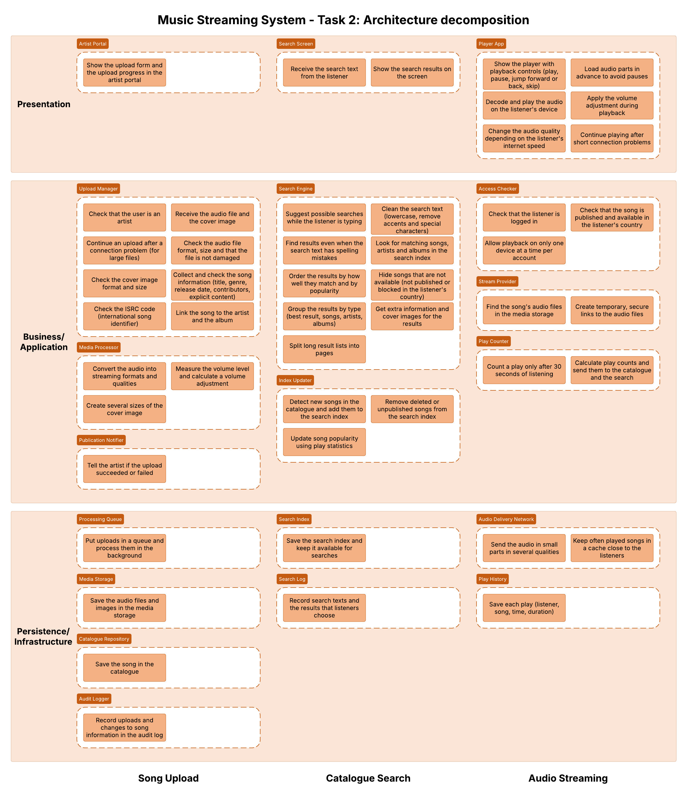
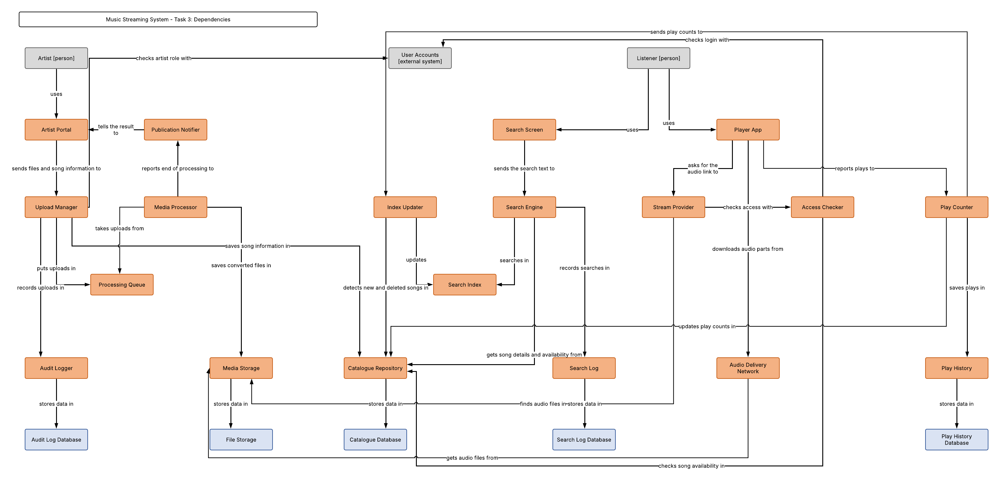
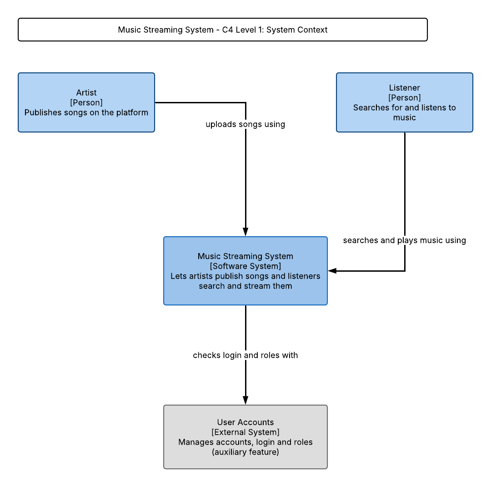
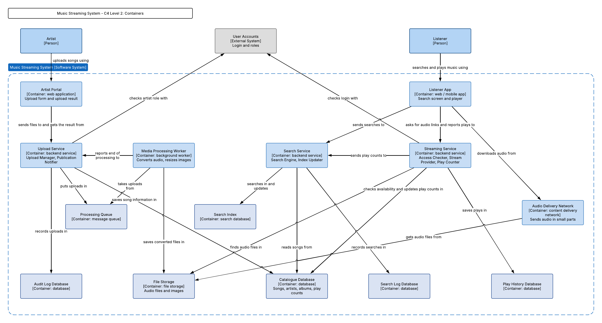

# Music Streaming System – Architecture (first draft)

This document contains our architecture work for the core features
Song Upload, Catalogue Search and Audio Streaming (see `features.md`).

## Task 2: Architecture decomposition

For each business area (one per core feature), we placed every responsibility in a layer
(Presentation, Business/Application, Persistence/Infrastructure). Then we grouped the
responsibilities that belong together into modules.

Lucid diagram: [Task 2 - Architecture decomposition (Lucidchart)](https://lucid.app/lucidchart/8a13cb37-50fd-452a-9b3b-f8d91db97765/view)

### Why we split the modules like this

**Song Upload**

- Upload Manager: all its steps work one after another to accept one valid upload.
- Media Processor is separate because converting audio is slow and must scale on its own.
- Publication Notifier is only responsible for notifications: it tells the artist the result of the upload.

**Catalogue Search**

- Search Engine: each step uses the result of the step before to answer one search.
- Index Updater is separate because it runs in the background: it watches the catalogue for new or deleted songs and updates the index.

**Audio Streaming**

- Player App runs on the listener's device; all its responsibilities are needed for continuous playback.
- Access Checker: all its responsibilities answer one question: "can this listener play this song now?"
- Audio Delivery Network is separate because it carries the biggest load and must scale on its own.

### Shared modules

- Catalogue Repository: used by Upload, Search and Streaming
- Media Storage: used by Upload and Streaming
- Audit Logger: can be used by all features

## Task 3: Dependencies

We kept only the modules, added the databases and the external elements (Artist, Listener,
User Accounts), and drew the dependencies between modules.

Diagram: [Task 3 - Dependencies (Lucidchart, page 2)](https://lucid.app/lucidchart/8a13cb37-50fd-452a-9b3b-f8d91db97765/view)

### Main design choices

- Song Upload does not depend on Search: Index Updater watches the Catalogue Repository for new or deleted songs.
- Catalogue Repository and Media Storage are the shared modules: Upload writes to them, Search and Streaming read from them.
- User Accounts is an auxiliary feature, so it is shown as an external system.

## C4 model

### Level 1: System Context

### Level 2: Containers

### Which modules are in which container

| Container                                                                                        | Modules                                                     |
| ------------------------------------------------------------------------------------------------ | ----------------------------------------------------------- |
| Artist Portal (web application)                                                                  | Artist Portal                                               |
| Listener App (web / mobile app)                                                                  | Search Screen, Player App                                   |
| Upload Service (backend service)                                                                 | Upload Manager, Publication Notifier, Audit Logger          |
| Media Processing Worker (background worker)                                                      | Media Processor                                             |
| Search Service (backend service)                                                                 | Search Engine, Index Updater, Search Log                    |
| Streaming Service (backend service)                                                              | Access Checker, Stream Provider, Play Counter, Play History |
| Processing Queue (message queue)                                                                 | Processing Queue                                            |
| Search Index (search database)                                                                   | Search Index                                                |
| Audio Delivery Network (content delivery network)                                                | Audio Delivery Network                                      |
| Catalogue Database, File Storage, Audit Log Database, Search Log Database, Play History Database | Catalogue Repository, Media Storage and the logs' storage   |
